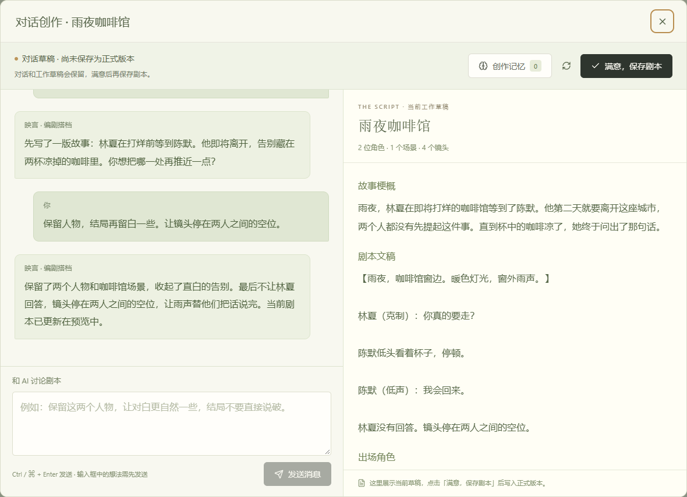
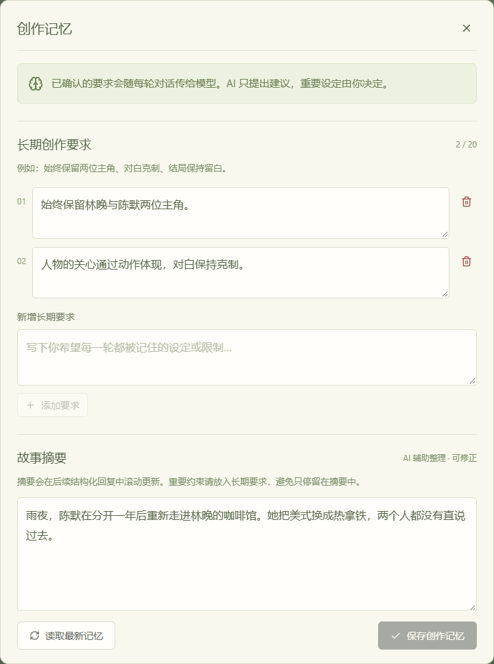

# 映言 · Yingyan

让故事中的人，开口说话。

面向中文写实剧情短片的创作工作台。这个独立仓库交付**第一阶段：故事到可编辑分镜**，为后续角色配音、口型视频和成片制作打基础。当前没有视频生成、配音生成、支付或计费功能。

代码仓库：[2151732002/yingyan](https://github.com/2151732002/yingyan)。后续版本继续提交到此仓库。



## 已实现

- 账号登录、服务端会话、退出登录、按账号隔离项目和素材。
- 创建、搜索、归档与重新启用故事项目。
- 编辑故事梗概、剧本文稿、场景光线和人物站位。
- 两位主要角色：身份、外貌、服装、声音设定、JPEG/PNG 参考图上传。
- 最多 12 个分镜：镜头排序、景别、出场角色、对白归属、情绪、语速、画内对白/画外音。声音字段目前是创作设定，不会播放或生成音频。
- 手动保存版本、刷新后恢复、查看不可变历史、恢复旧版为新版本、并发冲突提示与 JSON 草稿导出。
- 对话式 AI 编剧：创建故事名称后开始讨论，每轮根据最新草稿继续修改；对话与工作草稿保存在后端，满意后点击「满意，保存剧本」才创建正式版本。支持 OpenAI Responses 兼容接口，已用 DeepSeek 实际验证多轮创作。未配置密钥时可完整手工创作。
- 剧本创作记忆：每轮持续携带已确认要求和滚动摘要；AI 可提出待确认建议，用户可查看、编辑、采纳和撤销。记忆按剧本及账号隔离。
- 桌面和手机适配；提供“雨夜咖啡馆”示例，示例人物与画面占位不代表生成结果。

## 本地启动（Windows）

依赖：Java 21、Maven 3.9+、Node.js 24、npm。演示模式使用 H2 文件数据库，不需要 MySQL、Docker 或 AI 密钥。

在仓库根目录执行：

```powershell
powershell -ExecutionPolicy Bypass -File scripts/start-demo.ps1
```

打开 **http://127.0.0.1:3100**。未配置 `.env` 时，演示账号为 `director`，密码为 `yingyan-demo-2026`。脚本首次安装前端依赖并构建；已经安装依赖时可以传 `-SkipInstall`。若当前环境不能访问 Maven/npm 仓库，需要先配置可用的依赖源。

停止本次启动的进程：

```powershell
powershell -ExecutionPolicy Bypass -File scripts/stop-demo.ps1
```

数据保留在 `backend/data/`，进程记录和日志在 `.local/`，均不提交到 Git。后端监听 18080，前端监听 3100，不占用原项目的 8080/3000。

也可以分别启动开发服务：

```powershell
# 终端一，仓库根目录
mvn -f backend/pom.xml spring-boot:run "-Dspring-boot.run.profiles=demo"
# 终端二
cd frontend
npm ci
npm run dev
```

## 密钥与账号配置

如需修改初始账号或启用 AI，在**仓库根目录**将 `.env.example` 复制为 `.env`。Spring Boot 从后端目录启动时读取根目录文件，环境变量优先。无需把密钥放进前端。

```dotenv
YINGYAN_ADMIN_USERNAME=director
YINGYAN_ADMIN_PASSWORD=your-long-local-password
OPENAI_API_KEY=
OPENAI_TEXT_MODEL=gpt-4.1-mini
OPENAI_BASE_URL=https://api.openai.com/v1
```

只在自己的 `.env` 中填入真实 Key，不要发到聊天中、提交 Git、放进截图或使用 `NEXT_PUBLIC_*`。模板里的账号密码只是本地示例，启用前请修改。初始密码至少 12 个字符；账号只在数据库中不存在时创建，修改环境变量不会重置已有账号密码。

文本适配器使用 Responses API、严格 JSON Schema、服务端校验和 60 秒超时。支持已验证的 DeepSeek Responses 协议；其他 Base URL 仍需确认协议兼容。请求同步执行，没有伪造逐字流式显示。成功轮次和当前剧本草稿由 Java 保存；请求失败保留上一轮草稿和本次要求，允许手动重试，不自动重复付费调用。

DeepSeek 可使用以下配置，保留现有变量名；填入自己在 DeepSeek 平台创建的 Key：

```dotenv
OPENAI_API_KEY=your-deepseek-key
OPENAI_TEXT_MODEL=deepseek-flash
OPENAI_BASE_URL=https://api.deepseek.com
```

`deepseek-flash` 是官方当前 Flash 模型名称，实际模型代际以供应商说明为准。[DeepSeek Responses 文档](https://api-docs.deepseek.com/guides/responses_api/)

对话创作流程：新建故事并填写名称 → 输入第一条创作要求 → 连续提出人物、对白、情绪或结局的修改 → 查看当前完整剧本 → 点击「满意，保存剧本」。关闭弹窗或刷新后可以从「AI 编剧」继续；手机使用「对话 / 剧本预览」切换。每次发送携带最新完整草稿和最近 12 条历史消息，更早消息仍在对话界面保留，但不会全部重发给模型。未发送的输入尚未持久化，失败请求的要求则会保留。

在对话工具栏点击 **「创作记忆」**：

- **长期要求**：最多 20 条，每条最多 300 字。手动添加或采纳 AI 建议后，点击「保存创作记忆」才生效；全部已确认要求每轮都会传给模型，不受最近 12 条消息限制。
- **故事摘要**：最多 4000 字，随成功的结构化模型回复滚动更新，也可以手动修正；它是参考背景，不替代已确认要求。普通文字讨论或辅助摘要不合规时保留原摘要。
- **AI 待确认建议**：最多 8 条，只是建议，不会自动成为约束。采纳后仍需显式保存。
- **删除与恢复**：删除的要求会进入撤销列表，提醒模型不再沿用旧摘要中的同一约束。重新添加并保存可恢复；最近 40 条撤销记录随请求携带。

记忆保存不会创建正式剧本版本，也不会额外调用模型。摘要与建议复用原有对话请求；生成中禁止改记忆，多窗口版本冲突时保留本地编辑，允许显式读取最新记忆。记忆面板尚未保存的编辑只存在于当前页面。

升级不会自动重放或完整总结过去的全部聊天；摘要从后续对话逐步建立，旧的重要设定可以手动补入。当前没有跨剧本用户画像、向量检索或无限精确记忆，摘要可能存在偏差，需要时可人工修正。



每个项目同时只允许一个生成请求，使用 120 秒数据库租约，防止多个窗口重复发送；服务中断后租约过期可重新发送。其他窗口修改了正式剧本时，继续生成/保存会返回冲突，可选择从最新正式版本继续，对话记录保留。

如果模型返回普通讨论文字，对话会正常保留，并明确提示当前剧本草稿未改动；需要更新预览时，可以继续发送「请按以上方案更新剧本草稿」。程序不会把普通回复直接覆盖到剧本中，损坏或截断的结构化 JSON 仍会拒绝保存。

**现在需要额外开通服务吗？** 使用已有可用模型账号即可完成文本阶段；OpenAI 额度不能支付 DeepSeek 等其他厂商的调用。当前已通过本地私有配置完成 DeepSeek 两个成功轮次及显式保存的联调；单次返回仍可能无效，需要保留草稿并重试。未完成真实 OpenAI 线上验证。

面向国内用户上线时，需要选择在部署地区可用的服务；[OpenAI 官方支持地区](https://developers.openai.com/api/docs/supported-countries)当前不包含中国大陆。后续真实视频阶段再确认并开通对应的视频/口型模型、语音服务和对象存储。本阶段无需提前开通所有供应商。

## MySQL 与 Docker

默认后端配置使用 MySQL；`demo` profile 才切换为 H2。创建数据库和业务账号后，从 `backend` 目录启动：

```powershell
$env:DB_URL='jdbc:mysql://127.0.0.1:3306/yingyan?useUnicode=true&characterEncoding=utf8&serverTimezone=Asia/Shanghai'
$env:DB_USER='yingyan'
$env:DB_PASSWORD='your-database-password'
$env:YINGYAN_ADMIN_PASSWORD='your-long-local-password'
mvn spring-boot:run
```

表结构位于 `backend/src/main/resources/schema.sql`，启动时执行 `CREATE TABLE IF NOT EXISTS`。后续存在结构变更时应引入正式迁移；当前没有生产升级迁移方案。

安装 Docker 后，也可配置根目录 `.env` 的 `DB_PASSWORD`、`MYSQL_ROOT_PASSWORD`、`YINGYAN_ADMIN_PASSWORD`，执行：

```sh
docker compose up --build -d
docker compose down
```

Compose 提供 MySQL 8.4、Java 后端和 Next.js 前端，地址仍为 http://127.0.0.1:3100。数据库和参考图分别使用持久卷。当前环境未运行 Docker，不能将此部署文件视为已完成容器部署验收。不要使用 `down -v` 清理需要保留的数据。

## 技术与目录

Next.js 16.4.3 App Router、React 19.3.1、TypeScript、TanStack Query；Java 21、Spring Boot 3.5.13、MyBatis 3.0.5；MySQL / H2 演示数据库。具体锁定版本见 `frontend/package-lock.json` 和 `backend/pom.xml`。

```text
frontend/                 中文创作工作台、同源 API 代理、浏览器测试
backend/                  Java 业务接口、持久化、私有素材、AI 文本适配器
docs/design.md            已确认的完整产品设计与阶段边界
docs/api.md               第一阶段接口和版本语义
docs/verification.md      实际验证记录与限制
scripts/                  Windows 演示启动与停止
compose.yaml              可选 MySQL 容器部署配置
.github/workflows/ci.yml   后端、前端和浏览器自动检查
```

Next.js 将 `/api/*` 代理到 Java，业务与持久化由 Java 承担。素材真实解码校验，最大 5MB、2000 万像素，使用随机存储名，并通过登录权限接口读取。历史快照包含项目元数据和文档，恢复生成新修订，不覆盖历史；角色、场景、镜头和台词通过稳定 ID 关联。

## 验证

```powershell
mvn -B -f backend/pom.xml verify
cd frontend
npm ci
npm run lint
npm test
npm run typecheck
npm run build
# 自动启动已打包后端与已构建前端；本机需安装 Edge
$env:CI='true'
npm run test:e2e
```

Linux CI 使用 Playwright Chromium（先执行 `npx playwright install --with-deps chromium`，设置 `E2E_CHANNEL=chromium`）。浏览器测试启动前必须已生成后端 JAR 和前端生产构建。测试使用独立浏览器会话；演示数据库中会保留测试项目。

后端行为测试默认 H2；也可使用专用空测试数据库设置 `TEST_DB_URL`、`TEST_DB_USER`、`TEST_DB_PASSWORD`、`TEST_DB_DRIVER=com.mysql.cj.jdbc.Driver`。不要指向生产数据库。AI 协议测试使用本地 HTTP 替身，不消耗真实额度。

## 下一阶段

先完成 10–15 秒双人对白样片：明确角色参考、声音归属和正反打镜头，接入真实语音与单人说话口型视频，再做 FFmpeg 成片合成与局部重做。持久任务状态、失败恢复、供应商回调/轮询、资源审计和对象存储属于该阶段。

第一阶段只有管理员初始化账号，没有公开注册、找回密码、登录限流、内容审核或生产运维体系；当前交付用于本地验证和继续开发，不代表可直接公开运营。
